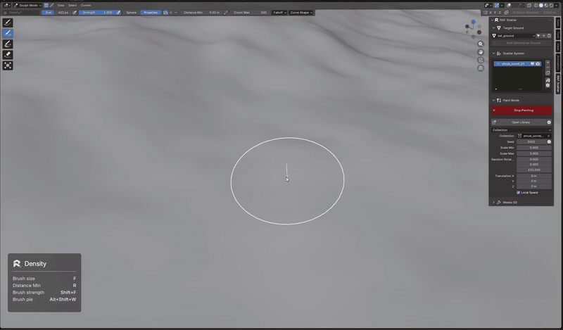

# RAF Scatter

**Ecosystem scattering toolkit for Blender.** Paint plants, rocks and any other asset onto a ground by hand, or let RAF Scatter distribute them procedurally — then shape the result with masks, save the whole setup as a biome, and share it as a biome pack.

**[Download](https://github.com/rafpictures-studios/raf-scatter/releases/latest)** · **[Documentation](https://raf-scatter-docs.vercel.app/)**

## Overview

- **Paint Mode** — five scatter brushes (Add, Density, Grow, Delete, Slide) with a ground-hugging ring cursor and an on-screen HUD.
- **Procedural Mode** — automatic distribution with Density, Distance Min and Seed.
- **Instances** — any object or collection, with random scale, rotation and offset; import straight from the Asset Browser.
- **Masks** — Texture, Position, Slope, Proximity and Vertex Group, each with optional Edge Blend.
- **Biomes** — save every scatter system of a ground as one preset and load it onto any other ground.
- **Biome Packs** (`.rafpack`) — bundle biomes with all their meshes, materials and textures into one file you can share or sell.

## Install

Requires **Blender 5.0+** (tested on 5.0 and 5.1).

1. Download `raf_scatter.zip` from [Releases](https://github.com/rafpictures-studios/raf-scatter/releases/latest). Do not unzip it.
2. **Edit > Preferences > Add-ons** → drop-down at the top right → **Install from Disk…** → select the zip.
3. Enable **RAF Scatter**, then press **N** in the 3D Viewport and open the **RAF Scatter** tab.

> GitHub's green **Code > Download ZIP** button is not an installable add-on — use the release zip.

## Author

Rizki Alfajri — RAF Pictures · [Instagram](https://www.instagram.com/rizqyalfajri/) · [YouTube](https://www.youtube.com/@rafpictures_studios)
